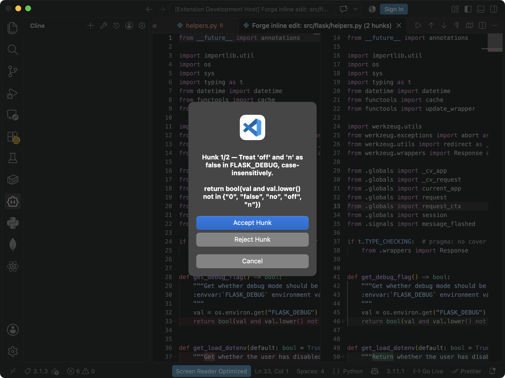
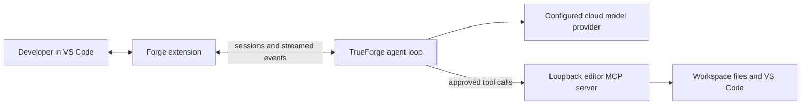

<p align="center">
  
</p>

<h1 align="center">Forge</h1>

<p align="center">
  <strong>An editor-native coding agent powered by TrueForge.</strong><br />
  Discover code, make reviewed multi-file changes, and keep the developer in control.
</p>

<p align="center">
  <a href="https://github.com/Mohak-Singhal/forge">Source</a> ·
  <a href="https://github.com/truefoundry/trueforge">TrueForge</a> ·
  <a href="https://github.com/cline/cline">Cline upstream</a> ·
  <a href="LICENSE">Apache-2.0 license</a>
</p>

<p align="center">
  
</p>

Forge is an open-source research prototype built from the Cline VS Code extension. Its agent loop runs on [TrueForge](https://github.com/truefoundry/trueforge); the extension connects the agent to the editor through loopback MCP tools and a human-reviewed diff flow.

> This repository is a source-run prototype, not a Marketplace release. The extension is built and launched from this repository.

## Why Forge

- **Editor-aware context:** repository maps, explicit file and symbol mentions, and BM25 retrieval with a hard token budget.
- **Safe edits:** proposed changes open in a VS Code diff; each hunk must be accepted before it is written.
- **Multi-file work:** the agent can discover relevant files, edit code and tests, and run workspace checks through approved tools.
- **Failure handling:** retries transient errors and can switch to a configured fallback model.
- **Undo and cancellation:** applied edits can be restored, and cancelled work leaves the workspace consistent.

## How it works



The extension starts a local MCP server on `127.0.0.1:8791` and registers it with TrueForge. TrueForge owns the model loop, tool calls, approvals, streaming, and fallback decisions. The extension supplies editor capabilities and renders the review experience.

| Editor tool | What it does | Approval |
|---|---|---|
| `editor_read_file` | Read a workspace file or line range | Automatic |
| `editor_search` | Search workspace files | Automatic |
| `editor_repo_map` | List source paths and top-level symbols | Automatic |
| `editor_retrieve` | Retrieve relevant chunks within a token budget | Automatic |
| `editor_diagnostics` | Run a fast Python syntax check | Automatic |
| `editor_propose_edit` | Propose exact hunks and apply only accepted hunks | Per hunk |
| `editor_run_command` | Run an approved workspace command | TrueForge approval |
| `editor_undo_last_edit` | Restore the exact pre-edit bytes | TrueForge approval |

## Run from source

### Requirements

- macOS or Linux
- Node.js 22 or newer
- Bun 1.4.2
- VS Code 1.96 or newer
- Git
- Python 3.11 or newer only for the Flask demo workspace

### Build the extension

```bash
GIT_LFS_SKIP_SMUDGE=1 git clone https://github.com/Mohak-Singhal/forge.git
cd forge
bun install
bun run build:sdk
(cd apps/vscode && bun run package)
```

`GIT_LFS_SKIP_SMUDGE=1` skips an upstream documentation GIF that is not needed to build Forge. The SDK build is required because the workspace packages resolve through their compiled `dist` directories.

### Start TrueForge and configure a cloud model

From the repository root, start TrueForge in local mode:

```bash
OUTBOUND_URL_ALLOWED_HOSTS='["127.0.0.1","localhost"]' npx @truefoundry/trueforge@latest
```

Open `http://localhost:8790/settings/models` and configure a cloud provider with an OpenAI-compatible API. Forge sends model traffic through TrueForge; it does not call model APIs directly. Keep provider keys in TrueForge's local configuration and out of this repository. Example provider shapes are in [`.trueforge/models.example.json`](.trueforge/models.example.json).

The reference configuration uses an OpenCode-compatible gateway as primary and Groq Cloud as fallback. Provider availability, model names, and prices can change; configure models that are currently available to you.

### Launch Forge in an Extension Development Host

From the repository root, open the workspace you want Forge to edit:

```bash
code --extensionDevelopmentPath="$PWD/apps/vscode" /absolute/path/to/workspace
```

In the Extension Development Host, open the Cline view in the Activity Bar, choose **Act**, and enter a task. Forge reads the agent definition from [`.trueforge/agents/forge-editor.json`](.trueforge/agents/forge-editor.json). Review each proposed hunk before applying it.

## Reproduce the Round 1 tasks

The demo workspace is Flask 3.1.3:

```bash
git clone https://github.com/pallets/flask.git flask-demo
cd flask-demo
git checkout 3.1.3
```

- **Task A — inline edit:** extend `get_debug_flag` so `off` and `n` are false, case-insensitively. After accepting the review, verify with `FLASK_DEBUG=off python -c "from flask.helpers import get_debug_flag; print(get_debug_flag())"`; it should print `False`.
- **Task B — agent mode:** ask Forge to add a `flask config` command that emits JSON and masks sensitive values. The agent should discover the implementation, test, and documentation files without being told their paths.
- **Task C — resilience:** make the configured primary endpoint unreachable, repeat Task A, and confirm Forge switches to the cloud fallback. Reject the proposed hunk and confirm the workspace remains clean. Restore the provider endpoint afterward.

## Development checks

From the repository root:

```bash
bun run build:sdk
cd apps/vscode
bun run check-types
bun run test:unit
bun run package
```

`package` runs type checks, lint, and the production build. The Round 1 verification scripts are in [`.unlazy/verify`](.unlazy/verify).

## Fork and license

Forge is based on [Cline](https://github.com/cline/cline), forked at commit [`eff43e19b267e171f597ab03733bfed25090f72d`](https://github.com/cline/cline/commit/eff43e19b267e171f597ab03733bfed25090f72d). The upstream `LICENSE` is preserved. Forge-specific changes are documented in [the fork ADR](docs/adr/0001-fork-cline.md).

## Contributing

Issues and pull requests are welcome. Please include a focused reproduction for bugs and run the relevant checks above before proposing a change. Do not commit API keys, provider credentials, or other secrets.
